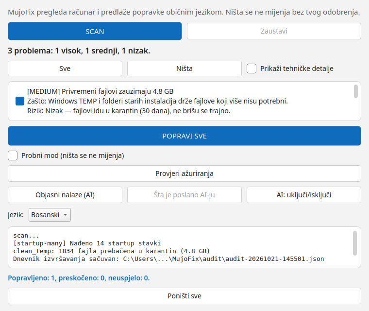
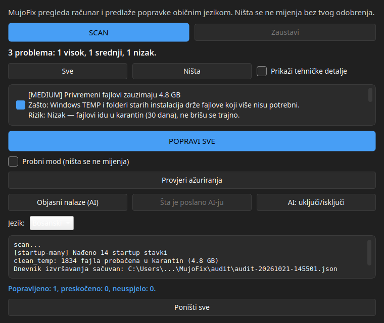

<div align="center">

# 🛠️ MujoFix

### AI mechanic for your Windows PC

**Click SCAN — the app finds issues, explains them in plain language, proposes a fix plan, you approve, it fixes, verifies, and rolls back if anything goes wrong.**

[](docs/STATUS.md)
[](LICENSE)
[](docs/STATUS.md)

[Bosanski/Hrvatski/Srpski verzija](README.md)

</div>

---

## ❓ What is MujoFix

MujoFix is an **open-source desktop app** that helps a non-technical user keep a Windows PC healthy. Instead of cryptic errors, the user sees:

> **"Your PC has 7 issues. 🔴 2 critical &nbsp; 🟠 3 medium &nbsp; 🟢 2 low"**

…and one **[ FIX ALL ]** button, with an expandable list (*"Show technical details"*) for advanced users.

Look and feel: **Fluent 2 / Windows 11** (Segoe UI, rounded controls, automatic light/dark theme) and a **Mica** backdrop where DWM provides it (Win11; a solid color otherwise). Language choice (**Bosnian / English**, applied on the next start) and remembered window size/position.

- Windows 10 (22H2) and Windows 11 (23H2+), x64. Works **without admin rights** (profile-level fixes); UAC elevation only when needed, explained beforehand.
- **Nothing changes without approval** (all / per-item / nothing).
- Every fix: snapshot → execute → **verify** → automatic **rollback** on failure.
- Fully usable **offline, without AI** (offline mode is the default until consent).

## ⬇️ Install (Windows, EXE)

Grab the latest from [Releases](https://github.com/xnet-ba/mujofix/releases):

1. **`MujoFix-Setup-<version>.exe`** — recommended (installer), or **`MujoFix-v<version>.zip`** — portable (unzip, run `MujoFix.exe`).
2. (Optional) verify the hash against the `SHA256SUMS.txt` from the same release:

```powershell
$a = (Get-FileHash .\MujoFix-Setup-0.2.0.exe -Algorithm SHA256).Hash.ToLower()
$b = ((Select-String .\SHA256SUMS.txt -Pattern "MujoFix-Setup-0.2.0.exe").Line -split '\s+')[0]
$a -eq $b   # must print True
```

3. Run the setup. It installs to `%LOCALAPPDATA%\MujoFix`, **no admin required** (current user only).
4. **The SmartScreen warning is expected** — the build is unsigned: *More info* → *Run anyway*.
5. A Start-menu shortcut is created; the **desktop icon is optional** (unchecked by default).
6. **Silent install:** `MujoFix-Setup-0.2.0.exe /SILENT` (or `/VERYSILENT`).
7. **Uninstall:** *Apps & features* → MujoFix. Removes the bundled OpenCode copy and app data (`%LOCALAPPDATA%\MujoFix`).

**Update:** `MujoFixCLI.exe update` checks for a new version; `update --apply` downloads it, verifies sha256 and launches the installer. The GUI has a *Check for updates* button. **Requirements:** Windows 10/11 x64 — **no Node or Python** (OpenCode is bundled and pinned).

*Untested:* the installer is compiled in CI on every push, but running it on a clean Win10/Win11 VM is still pending ([Issue #1](https://github.com/xnet-ba/mujofix/issues/1)).

## 🔄 How it works

1. **SCAN** — scanner plugins run **in sequence**, progress bar, cancellable. A module error never crashes the app — it becomes a *skipped* entry.
2. **ANALYZE** — each finding: severity (`CRITICAL / MEDIUM / LOW`), impact, fix risk, reversibility flag.
3. **PLAN** — AI drafts steps and order (action + target from the catalog); every step passes the validator before it is even shown. User approves.
4. **EXECUTE → VERIFY → ROLLBACK** — per-step snapshots; failed verification restores the step automatically.
5. **REPORT** — count of fixed / skipped / failed steps + **"Undo all"** via rollback points. (Before/after metrics — freed GB and boot time — are **not implemented**: boot time is not measured anywhere in the code, see `scanners/startup.py`.)

Anti-hallucination: the AI talks **only about evidence the scanner collected**; uncertainty is explicit; every proposal passes a validator (JSON schema + action allowlist). The AI never executes anything — a deterministic executor runs only catalog actions.

## 🖼️ Look and feel

Fluent 2 / Windows 11: Segoe UI, rounded controls, automatic light/dark theme and
a Mica backdrop on Win11. Screenshots are from the real app (offscreen render,
Bosnian UI):

<p align="center">
  
  
</p>

## 🧩 Scanners

Startup, services, disk, network, configuration, drivers, large files & duplicates (never auto-deleted, review only), suspicious processes ("suspicious, reasons: …" — never "virus"), permissions (disabled UAC = CRITICAL, ACLs, shares). Every module degrades gracefully on unsupported Windows versions.

## 🤖 AI layer

Bundled, pinned OpenCode as a child process (`opencode run`, no local server, no port, no password — nothing is exposed on the network; MujoFix is an installable Windows app only). The `mujofix` agent has **all built-in tools denied** — only MujoFix MCP tools (read-only + plan validator). Fallback chain: model A → B → C → offline. With consent, the app runs the CLI as a child process and uses a **free Zen model** (e.g. `opencode/beam-free`); if the binary or a free model is unavailable it silently falls back to **offline** with an honest reason in the log. *Untested:* the live path has not yet run on a Windows VM ([Issue #1](https://github.com/xnet-ba/mujofix/issues/1)). Consent screen first (what is sent, to whom, real payload example); anonymized before sending; Zen free-tier data terms are **confirmed** (checked 2026-10-18 against the [ToS](https://opencode.ai/legal/terms-of-service) and [Zen docs](https://opencode.ai/v2/docs/console/models/)) — a free Zen tier is **not private**: unpaid accounts' content may be used to improve the service, some free models may use collected data to improve the model during their promo period, and OpenAI/Anthropic requests are retained 30 days.

## 🛡️ Safety

Hard-coded blacklist in the AI-plan validator (System32, WinSxS, Program Files, user Documents/Pictures/Desktop/Downloads, boot configuration/Boot BCD, BitLocker, Defender — the whole of `C:\Windows` is *not* blocked, since `Windows\Temp` and the WU cache are legitimate targets), a **per-action snapshot** (restores exactly the state the action changes: previous registry value, service/task state) plus file quarantine (30 days, not deletion). A dry-run mode (GUI checkbox: nothing is changed) and a readable per-step log in the window; after every fix run a **JSON run log** is written to `%LOCALAPPDATA%\MujoFix\audit\audit-<timestamp>.json` (all step phases + summary; the path is printed in the log). **Not implemented:** System Restore Point (needs admin/Checkpoint-Computer) — the safety net is the per-action snapshot + rollback. Never disables antivirus/firewall/updates.

## 🚦 Status

All phases (0–6) are implemented in code and validated **host-direct on a real Windows 11 machine**: full scan (9/9 scanners, 0 skipped), the 3 host-proven fix actions (of 7 in the catalog: startup, temp, service) with apply → verify → rollback, GUI smoke, and spike checks 1–2. 191 unit tests pass locally (Linux, Qt offscreen); CI is green on Ubuntu and Windows. The extended Win10 + Win11 clean-VM matrix remains an **optional** follow-up — see [docs/TESTING.md](docs/TESTING.md). The build is unsigned (SmartScreen warning expected).

## ⚠️ Disclaimer

**This tool changes system settings and comes WITHOUT ANY WARRANTY.** Back up important data first. Changes can only be undone within the built-in rollback (per-action snapshot + 30-day quarantine; System Restore Point is not implemented). Nothing here is "100% safe".
